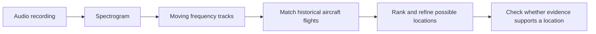
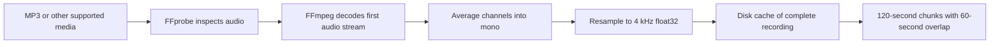
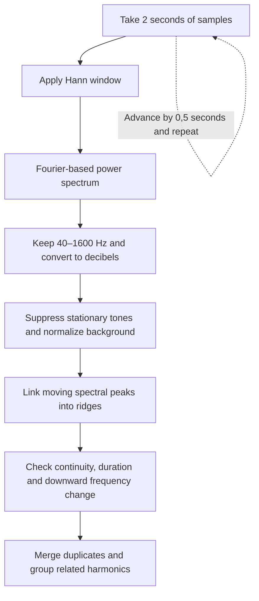
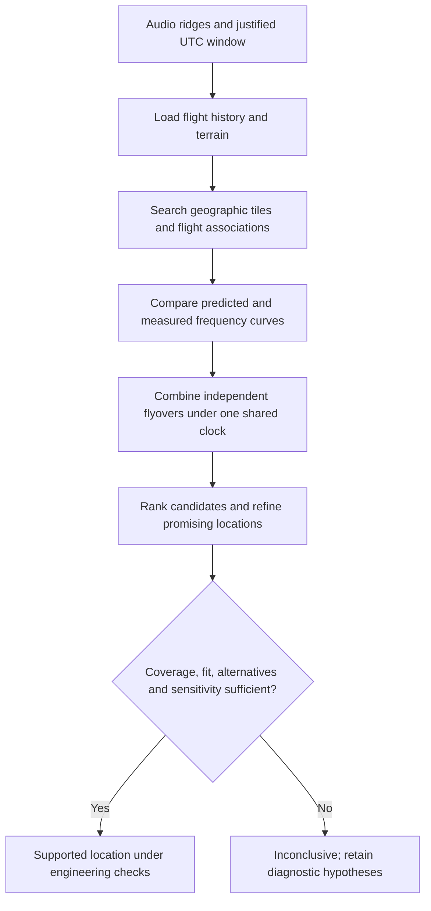

# How DOPPLERGEIST works

A quick overview of the default automatic `analyze` / browser-upload workflow.
The model uses **Doppler physics**, rather than a trained neural network that
predicts coordinates.

## 1. Audio preprocessing, length and restrictions

- **Length:** no fixed recording duration; whole recordings, including hour-long
  inputs, are scanned. Chunking bounds working memory.
- **Usable events:** the default detector requires a moving-tone track lasting
  at least **12 seconds**. A longer clip does not guarantee a usable event.
- **Frequency range:** discovery examines **40–1,600 Hz**. Faint, short, steep or
  out-of-band tones may be missed.
- **Limits:** browser uploads default to **100 MiB**; analysis defaults to
  **one hour of processing time**, not one hour of audio. Operator settings can
  change these limits.
- **Recording time:** flight matching needs a defensible UTC window for the
  **first decoded sample**. Upload time and file modification time are not
  recording clocks. Missing timing evidence produces `needs_input`.
- There is no general speech-removal or learned denoising step.

Implementation: [intake.py](../src/dopplergeist/intake.py).

## 2. Extracting the spectrogram and events

A spectrogram maps **time × frequency → signal power**.

- Uses SciPy's `signal.spectrogram`: **8,000 samples per window**, **0.5-second
  hop**, and **0.5 Hz frequency-bin spacing** at the default sample rate.
- Subtracts each frequency's median over time, then normalizes each frame using
  its median and median absolute deviation to emphasize moving tones.
- A **ridge** is a measured frequency curve over time. Related harmonics count
  as one event, rather than independent flyovers.
- These are **acoustic proposals**, not confirmed aircraft detections.
- The configured research `measure` path differs: its defaults use a
  **0.25-second hop** and FFT zero-padding. Padding does not improve physical
  frequency resolution.

Implementation: [discovery.py](../src/dopplergeist/discovery.py),
[audio.py](../src/dopplergeist/audio.py).

## 3. What the model predicts

**Question:** what would a microphone at this location hear from this flight?

| Input | Purpose |
| --- | --- |
| Historical ADS-B trajectory | Aircraft position, velocity and time |
| Candidate microphone position and terrain | Distance, viewing direction and receiver height |
| Sound speed and source-tone parameters | Doppler shift and sound travel time |

- Approaching aircraft raise the observed tone frequency; receding aircraft
  lower it.
- The model predicts the **frequency-versus-arrival-time curve**. It evaluates
  aircraft motion when the sound was **emitted**, accounting for travel delay.
- It compares that prediction with the measured ridge; unknown source-tone
  parameters are fitted during matching.
- Flight gaps and inconsistent altitude information limit support. The model
  assumes a stationary microphone and simplified acoustic propagation.

Implementation: [geometry.py](../src/dopplergeist/geometry.py),
[matching.py](../src/dopplergeist/matching.py).

## 4. From predictions to a position estimate

- Default search spacing is **2,000 m coarse / 100 m refinement**, followed by
  physical position/clock refinement. **Grid spacing is not achieved accuracy.**
- All discovered independent groups are considered by default; harmonics count
  once, and unconfirmed proposals may remain unmatched. There is no default
  two- or three-event cap.
- Normally at least **two independent flyovers** are required. A single-event
  exception needs trusted timing and additional evidence.
- Default fit checks include **≤3 Hz event RMSE**, **≤25% outliers** and
  **≥95% trajectory support**. These alone do not establish a location.
- Missing data, exhausted search budgets, competing locations or insufficient
  sensitivity evidence can force an **inconclusive** result.

### Accuracy: target versus demonstrated performance

- **Target:** within **1,000 m**, preferably **100–500 m or better**. Evaluation
  reports outcomes at **100, 500 and 1,000 m**.
- **Main limits:** recording-clock error, ambiguous tones, incomplete or inaccurate
  flight tracks, altitude errors, poor flight geometry, changing engine tones,
  wind and simplified sound propagation.
- **No accuracy guarantee:** independent blind real-recording accuracy and
  false-localization rates have not been established. A sensitivity radius is
  not a calibrated confidence interval; a ranking score is not a probability.
- A top-ranked coordinate can still be unsupported. See the
  [README results](../README.md#experimental-results) for measured outcomes and
  their conditions, including unsuccessful and inconclusive cases.

Details: [decision rules](CONFIDENCE.md), [upload workflow](PRODUCT.md),
[physical methodology](METHODOLOGY.md).
