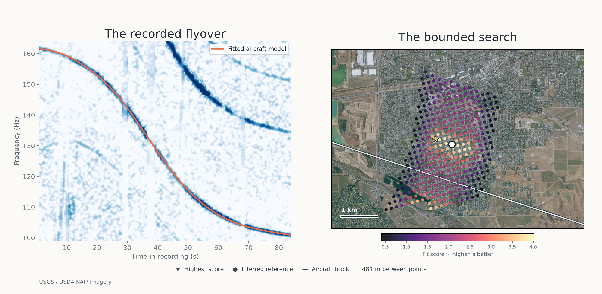

# A bounded real-audio demonstration: Livermore



This is a configured research run on **N784MB_R04**, a smartphone recording and
an accompanying aircraft track from [Praveen Pathak's Livermore dataset](https://doi.org/10.5281/zenodo.23424278)
(CC BY 4.0). We ran DOPPLERGEIST at `8c19362` on the original WAV and the
published KML track. The plot overlays the best physical model on the recording
and shows scored grid points for its selected track segment. Colors are raw fit
scores, not probabilities; locations with no plotted point were not assigned a
score in this visualization.

The highest-scoring point is **481 m from an inferred reference**, not surveyed
microphone ground truth. That reference was reconstructed from published flight
tracks and reported closest-track offsets across the same dataset. The fit excludes
the target passage, rejects three of the remaining 39 cases with residuals above
150 m, and has a 4.76 m RMS residual on the remaining 36. This is a model-derived
common-site reference, not a surveyed microphone coordinate. The search used a
Livermore city-area prior chosen before the reference was calculated. This
separation is **not an independent measurement of location accuracy**. The
candidate is within 500 m and 1,000 m of the inferred reference, but not 100 m; the unknown reference error prevents
those figures from establishing those accuracy thresholds.

The configured run supplied one aircraft's track, the recording's full 0–85 s
window and the 99–164 Hz band, a roughly 10-second start-time interval derived
from the published UTC ridge and WAV duration, and a regional search box. The
published ridge constrains sample zero only if the entire annotated passage is
within this audio file; it is not an independently measured recording clock.
The midpoint was `2026-05-14T17:41:32.238656Z`, with a ±5.01 s scoring sweep
in 0.5 s steps. The winner lies at the early edge of that sweep, 0.01 s earlier
than the estimated lower bound; its clock is therefore particularly sensitive to
the imposed boundary. Terrain was held at 150 m above mean sea level with an
EGM96 geoid conversion. The run scored 358 grid points and retained 407 rows
including refinements. Its model assessment is incomplete: one track segment was
unsupported at each of three CPA stages, and all 407 scored candidate clock
envelopes were unclassified by the legacy brightness scorer. The program marked
`accepted_location: false`. One pass also permits competing geometries; the
plot does not rule them out.

A separate fresh configured two-flyover replay on the same code placed its
leading candidate 43.86 m from an approximate public reference, also with
incomplete model support. Both are development examples, not automatic or
independent real-world acceptance. The original Livermore run reported 38.8 seconds; the separate fresh replay used
for the figure reported 20.7 seconds. Runtime depends on hardware and load.

For the subsequent full-archive MP3 upload and its ranked candidates, see the
[all-aircraft ranked run](LIVERMORE_RANKED_RUN.md).

## Separate automatic MP3 upload

The same real recording was also encoded to MP3 and submitted to the local API
at `8c19362`. The upload workflow discovered two acoustic groups without supplied
event windows or frequency bands. It used the roughly 10-second time interval,
a reference-derived area and an index containing only the known N784MB track.
One group was matched; the other was left unmatched. Its leading diagnostic
candidate was about **158 m from the inferred reference**. This is a different
run from the configured figure above, and the distance is not surveyed error.
The result was **inconclusive / search_incomplete**: the single-aircraft index
does not establish competing-flight coverage, and 91 score candidates and
1,391 clock trials remained unclassified. All four local tiles were visited,
but that does not make the overall search or physical-model assessment complete.
The run reported 274.5 seconds total and 33.0 seconds in search on the local
machine. No automatic location was accepted.

## Fresh MP3 ranking with a corrected altitude datum

A second full local HTTP upload replay on source `7565d81` used the same real
MP3, the published N784MB track converted from EGM96 mean-sea-level heights to
ellipsoidal heights, the same approximately 10-second clock interval, and a
Livermore city-area box (`-121.84, 37.65, -121.70, 37.73`). The detector
selected event groups automatically. The search visited **6 of 6 tiles** and
1,754 grid points, completed refinement, and returned **105 ranked candidates**.
The top candidate scored 0.928432 and was **110 m from the inferred reference**;
the comparison is not a measured microphone-location error.

The table presents the first five candidates in original score order after a
250 m minimum spacing filter, to avoid listing near-duplicates. Original ranks
are retained; the scores are uncalibrated fit scores, not probabilities.

| Original rank | Latitude | Longitude | Score | Distance from inferred reference |
| ---: | ---: | ---: | ---: | ---: |
| 1 | 37.662455 | -121.781083 | 0.928432 | 110 m |
| 12 | 37.661549 | -121.777135 | 0.925876 | 457 m |
| 13 | 37.662693 | -121.784670 | 0.925206 | 253 m |
| 20 | 37.663934 | -121.787489 | 0.922637 | 502 m |
| 52 | 37.661666 | -121.787273 | 0.901400 | 506 m |

The final result remains `inconclusive / search_incomplete`: all geographic
tiles were visited, but the source index contained only the known aircraft and
therefore did not establish competing-flight coverage. The scorer recorded
618 candidate envelopes with 10,434 unclassified clock trials, all with stored
bounds; `model_assessment_complete` was true, while full model support and data
scope were not. This is a ranked, prior-constrained development result, not an
accepted location or proof that the reference is correct. The complete original
ranking and job artifacts are available locally under
`/home/cinna/.local/state/dopplergeist-livermore-replay-20261103/`.

## All-aircraft archive MP3 ranking

A further end-to-end HTTP upload of the same MP3 searched a regional index
prepared from the [ADSB.lol daily archive](https://github.com/adsblol/globe_history_2026/releases/tag/v2026.05.14-planes-readsb-staging-0).
The archive contained 69,762 traces; conservative selection retained **466
nearby aircraft**, including jets and unknown types, with 5,341 indexed track
segments. The approximately 10-second recording-start window was unchanged. The search
used the Livermore city-area box (`-121.84, 37.65, -121.70, 37.73`), originally
chosen before the inferred reference was calculated. Event windows, frequency
bands, and flight IDs were not supplied to the upload.

The job searched **12 of 12 tile pieces** and 1,754 grid points with 250 m
coarse spacing, refined its candidates at 100 m, and returned **105 ordered
results**. Its declared archive coverage
was complete for the requested region and time. The first five spatially
distinct locations below are selected in score order with a minimum separation
of 250 m; original ranks remain visible. Distances are to the inferred reference,
not to surveyed microphone truth.

| Original rank | Latitude | Longitude | Score | Distance from inferred reference |
| ---: | ---: | ---: | ---: | ---: |
| 1 | 37.664126 | -121.787149 | 0.935434 | 476 m |
| 10 | 37.662932 | -121.783568 | 0.927466 | 152 m |
| 20 | 37.662790 | -121.779953 | 0.921463 | 176 m |
| 29 | 37.661549 | -121.777135 | 0.917187 | 457 m |
| 48 | 37.661666 | -121.787273 | 0.901372 | 506 m |

The [complete 105-candidate ranking](../benchmarks/livermore-all-aircraft-ranking-20261103.json)
is retained in original order. The README figure plots the highest retained
score per receiver point from the saved search tiles and highlights ranks 1 and
10; it is a cropped map, not a plot of every searched point. Scores are fit
measures, not probabilities.
Despite full declared archive coverage, the result remains **inconclusive**:
187 CPA track evaluations exceeded the supported trajectory model. The scorer
also recorded 725,947 unknown clock trials across 40,531 candidate envelopes,
all with bounds. These are work evaluations, not separate aircraft. A searched
archive cannot establish that its receivers captured every actual flight. Thus
the listed distances are useful comparisons, not verified localization errors.
The upload and search ran on source `7565d81` in 651 seconds, excluding the
earlier archive download, selection, and indexing.

## Reproduce

Install the project as described in the [README](../README.md). Download
`Raw data_V_constant_H_constant.zip` from the dataset page, verify its published
MD5 `d34b32ae57477074d6e8563300a7fc19`, and extract the `N784MB_R04` folder.
Obtain an EGM96 geoid raster compatible with DOPPLERGEIST, for example
`data/terrain/us_nga_egm96_15.tif` from the project checkpoint's `data-terrain`
bundle. Use new output directories:

```bash
PYTHONPATH=src python scripts/prepare_livermore_demo.py \
  path/to/V_constant_H_constant/N784MB_R04 \
  data/terrain/us_nga_egm96_15.tif results/livermore-prepared
PYTHONPATH=src python -m dopplergeist.cli run \
  results/livermore-prepared/config.json --output results/livermore-run
```

To reproduce the inferred reference, extract all four dataset ZIPs under
`path/to/dataset/extracted/` with their category directories intact, then run:

```bash
PYTHONPATH=src python scripts/compare_livermore_reference.py \
  path/to/dataset results/livermore-run
```

The imagery in the figure comes from [USGS The National Map / USDA NAIP](https://imagery.nationalmap.gov/arcgis/rest/services/USGSNAIPImagery/ImageServer).
To reproduce the graphic, download the public-domain USGS image for the fixed
extent and pass it to the renderer:

```bash
curl -G 'https://imagery.nationalmap.gov/arcgis/rest/services/USGSNAIPImagery/ImageServer/exportImage' \
  --data-urlencode 'bbox=-121.82,37.642,-121.74,37.687' \
  --data-urlencode 'bboxSR=4326' --data-urlencode 'imageSR=4326' \
  --data-urlencode 'size=1600,900' --data-urlencode 'format=jpg' \
  --data-urlencode 'f=image' -o results/livermore-naip.jpg
PYTHONPATH=src python scripts/render_livermore_demo.py \
  results/livermore-run results/livermore-naip.jpg results/livermore-demo.png
```

To reproduce the automatic MP3 figure from its saved job directory, the same
NAIP image, and the flight index used by that job:

```bash
PYTHONPATH=src python scripts/render_livermore_automatic.py \
  path/to/automatic-upload-job path/to/all-aircraft-index.sqlite \
  results/livermore-naip.jpg results/livermore-automatic.png
```

The live imagery service may serve a newer aerial image in the future. See
[Dopplerprint comparison](DOPPLERPRINT_REVIEW_2026-11-03.md) for the limits of
the related dataset's reconstructed reference and other real-data work.
